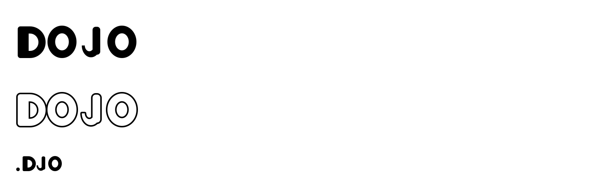

# Fonts

Two typefaces are planned, both drawn as vectors and assembled into real font
files (`.ttf` for print and desktop, `.woff2` for the web) by the build script
in `tools/`:

| Project | Folder | For |
|---|---|---|
| **Learning Dojo** | `learning-dojo/` | the coloring books: the display face for titles and the four word tags. Chunky, rounded, wide open counters so the inside of each letter can be colored. Latin letters, digits and punctuation only; Korean, Japanese and Hanja keep the Noto fonts. |
| **JAISHOSTUDIOS brand script** | private repo (see below) | the company's own calligraphic brand font. Same toolchain; the source glyphs stay out of this public repo. |

## The programs

- **Inkscape** draws the letters. You already know it; nothing else is needed
  to produce the vectors.
- **`tools/build_font.py`** turns the SVG files into a font. It needs Python 3
  with `pip install fonttools skia-pathops brotli pillow`. No font editor is
  required for a working font.
- **FontForge** (free, Mac/Windows/Linux) is the optional second step for
  polish that the script does not do: kerning pairs, hinting, OpenType
  alternates. Open the built `.ttf` in FontForge, adjust, and re-export.
  Do not draw in FontForge; its drawing tools are far worse than Inkscape's.
- **Calligraphr** (calligraphr.com, free tier) is the fast path for a
  *hand-lettered* face: print its template sheet, write every character with a
  real brush pen, scan or photograph the sheet, and it returns a `.ttf`. Its
  letters are rough traces, so the useful flow is Calligraphr for the first
  draft, then export each glyph, clean it in Inkscape, and rebuild here.

## Workflow in Inkscape

1. `python3 fonts/tools/build_font.py init fonts/learning-dojo` creates one
   SVG per character in `glyphs/` from `tools/glyph_template.svg` (already
   done for the Learning Dojo charset: 74 files).
2. Open a glyph file. The locked GUIDES layer shows the baseline (red), cap
   height (blue, 700), x-height (green, 500), ascender (750) and descender
   (-200). Draw on the **Glyph** layer only.
3. Draw the letter as **filled black shapes**. Pen tool, shapes, or a
   calligraphy stroke: anything, as long as at the end it is a filled path.
   - A stroke must become a shape: *Path > Stroke to Path*.
   - Several pieces of one letter: *Path > Union* so that counters (the hole
     in an O) come out as holes. Leftover overlaps are removed by the build.
   - Text objects must become paths: *Path > Object to Path*.
   - Ungroup everything (*Shift+Ctrl+G* until no groups remain).
4. Set the advance width: the **page width is the advance**. Leave the gap you
   want on the left and right of the drawing and drag the page width in
   *Document Properties*, or *Edit > Resize Page to Selection* and then add
   equal margins. Keep the page height at 1000.
5. Save as **Plain SVG** or Inkscape SVG, same file name.
6. `python3 fonts/tools/build_font.py build fonts/learning-dojo` writes
   `build/LearningDojo-Regular.ttf`, `.woff2`, `specimen.png` and
   `specimen.html`. Install the `.ttf` to test it in Inkscape or Moda.
7. `python3 fonts/tools/build_font.py check fonts/learning-dojo` lists which
   characters still have an empty file.

Order of work for the coloring-book face: the letters in the 32 animal names
first (`A B C D E F G H K L M O P R S T Z` and the lowercase set), then digits
for page numbers, then the rest.

## Conventions the build relies on

- File name = glyph name: `A.svg`, `a.svg`, `zero.svg`, `period.svg`,
  `question.svg`, `ampersand.svg`. Names follow the Adobe Glyph List; anything
  else can be written as `uni4E2D.svg`.
- 1000 units per em, baseline at y = 800 on a 1000-tall page. Changing the
  page height scales the glyph, so leave it.
- `font.json` carries the family name, metrics, designer and the charset used
  by `init` and `check`.
- `tools/example/` is a self-test: four hand-written glyphs that must always
  build. Run it after changing the script. Its output is committed as
  `tools/example/build/specimen.png` so the expected result is visible:

  

## Later

- Kerning (pairs such as `AV`, `To`) in FontForge once the alphabet exists.
- A Bold or Outline style for the colorable lettering, built from the same
  glyphs with *Path > Outset* / *Dynamic Offset* in Inkscape.
- The brand script font: the JAISHOSTUDIOS calligraphy work lives outside
  this repository. Point the toolchain at its folder with
  `build_font.py build <that-folder>`; the folder only needs a `font.json` and
  a `glyphs/` directory.
